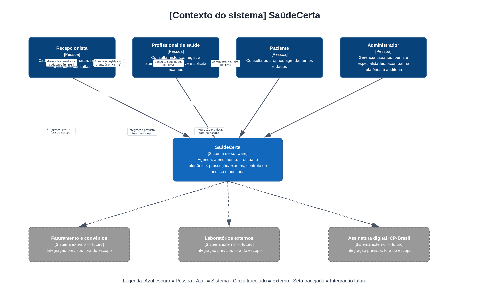
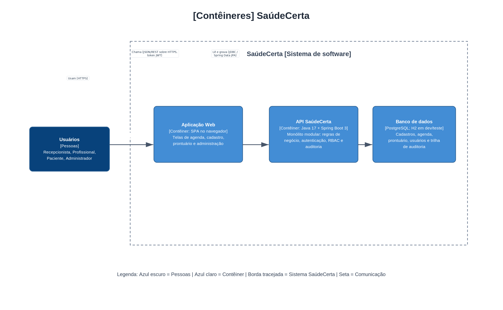
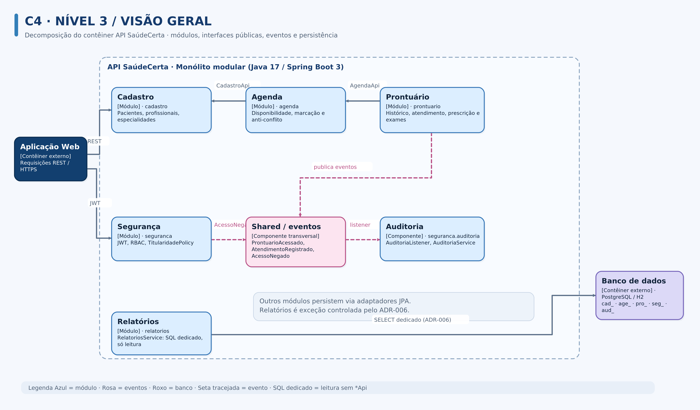
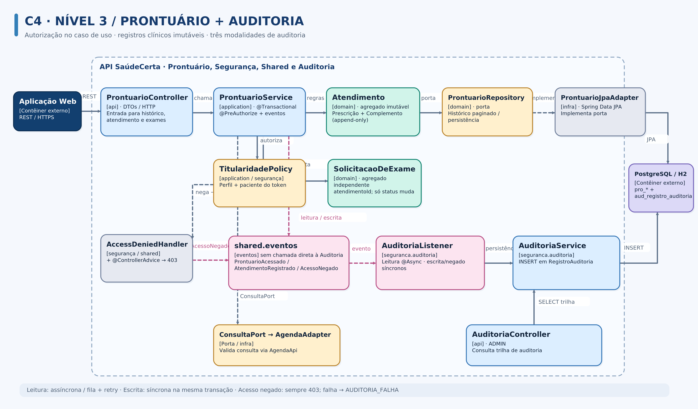
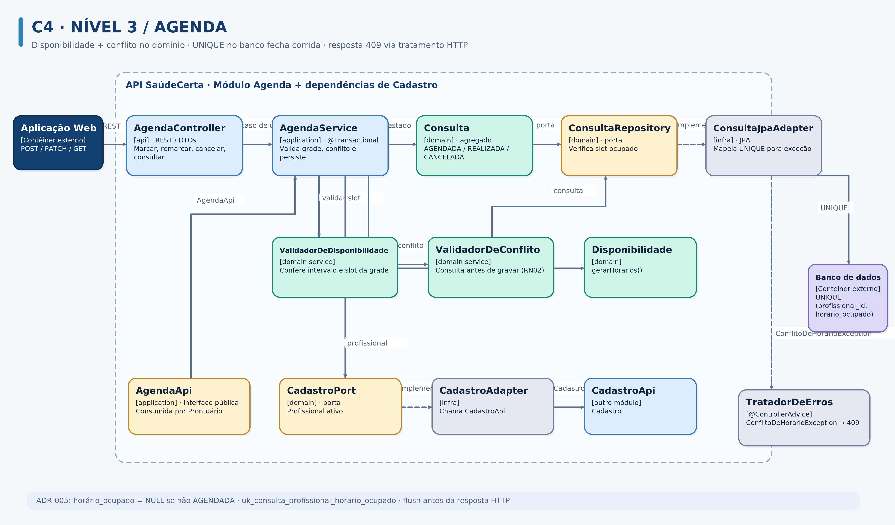
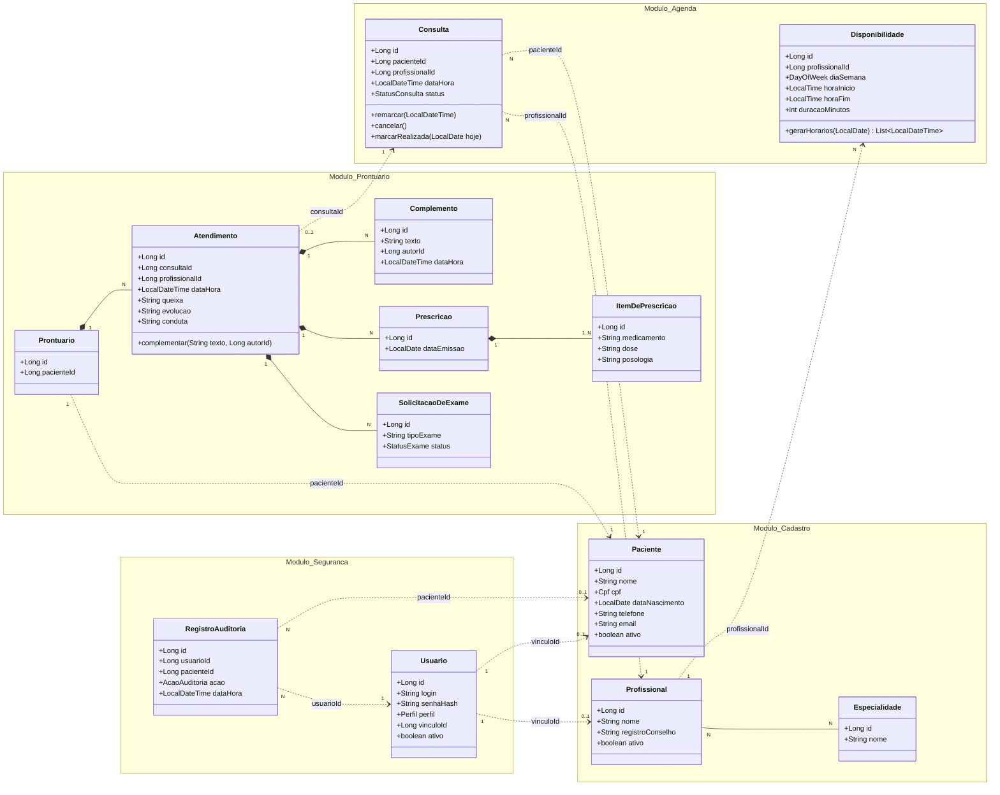

# SaúdeCerta — Projeto Arquitetural (E2)

**Disciplina:** TEADS0347 — Desenvolvimento de Aplicações Multicamadas
**Turma:** NOITE C795NL
**Docente:** Márcio Goes do Nascimento
**Período:** 2026.2
**Entrega:** E2 — Projeto Arquitetural

**Equipe:**
| Nome completo |
|---|
| Edson Davi Farias Martins |
| Marcus Carreira Júnior |
| Vergílio Junior |

**Repositório Git:** `https://github.com/Dex057/equipe-02-saudecerta`

---

## 1. Introdução e premissas

Este documento transforma os requisitos da E1 ([`visao.md`](visao.md) e [`requisitos.md`](requisitos.md)) em arquitetura. Ele contém: diagramas C4 (seção 2, fonte editável em `arquitetura.drawio`), camadas e componentes (seção 3), modelo de domínio (seção 4) e cenários de qualidade (seção 5). As decisões estão em [`adr/`](adr/README.md) e a matriz de rastreabilidade em [`rastreabilidade.md`](rastreabilidade.md).

A E1 deixou como ponto central a tensão entre **segurança/auditoria** (RNF01, RNF02, RNF07) e **desempenho/usabilidade** (RNF03, RNF06). Todas as decisões abaixo foram tomadas olhando para essa tensão, e cada ADR diz qual lado ela favorece e o que custa.

**Premissas assumidas pela equipe** (não vêm do guia do caso; estão aqui para ficarem explícitas e poderem ser contestadas):

- **P1 — Front-end.** A disciplina avalia a arquitetura e a API (E3). A aplicação web (SPA) aparece nos diagramas como contêiner, mas sua tecnologia não está definida e ela não é entregue no protótipo; a API será exercitada por Postman/Insomnia.
- **P2 — Volume de referência.** Para dimensionar os cenários de desempenho, assumimos até 50 mil pacientes e 500 mil consultas na base. É uma premissa a ser validada com dados sintéticos no E3.
- **P3 — Horários de duração fixa.** A agenda de um profissional é dividida em horários de duração fixa (por exemplo, 30 min), gerados a partir da disponibilidade (RF03). Assim, "mesmo horário" (RN02) significa "mesma data/hora de início".
- **P4 — Implantação simples.** Uma instância da API e um banco de dados. Alta disponibilidade com réplicas está fora do escopo (justificativa no ADR-001 e na seção 5).
- **P5 — Convenção de nomes.** Pacotes em `br.edu.ifpa.saudecerta.<módulo>.{api,application,domain,infra}`, como sugerido no guia. Os nomes de componentes usados nos diagramas, nas ADRs e na matriz são os mesmos.

---

## 2. Diagramas C4

### 2.1 Nível 1 — Contexto do sistema

Mostra o SaúdeCerta como uma caixa preta, quem o usa e o que está ao redor. Os sistemas externos tracejados **não existem hoje**: são as extensões futuras listadas como fora do escopo no guia (faturamento/convênios, laboratórios, assinatura ICP-Brasil). Ficam no diagrama para mostrar onde o sistema vai crescer (RNF05).


*Fonte editável: [arquitetura.drawio](arquitetura.drawio), página 1.*

### 2.2 Nível 2 — Contêineres

Abre o SaúdeCerta em unidades executáveis/implantáveis. São três: a aplicação web, a API (monólito modular, ADR-001) e o banco de dados. A auditoria **não** é um contêiner separado: roda dentro da API, alimentada por eventos: assíncrona na leitura e síncrona na escrita e no acesso negado (ADR-002).


*Fonte editável: [arquitetura.drawio](arquitetura.drawio), página 2.*

### 2.3 Nível 3 — Componentes da API

O contêiner **API SaúdeCerta** é um monólito modular (ADR-001), com camadas `api / application / domain / infra`. Os diagramas C4 nível 3 abaixo mostram a estrutura de componentes e as dependências permitidas. **A API de Relatórios é uma exceção controlada**: em vez de chamar `CadastroApi` e `AgendaApi` para agregar dados, utiliza consultas SQL dedicadas e somente leitura, autorizadas pelo ADR-006 e verificadas por ArchUnit.

#### 2.3.1 Visão geral dos módulos

As setas de dependência de código entre módulos passam pelas interfaces `*Api`; os eventos são publicados em `shared.eventos`. As checagens de autorização valem para todos os casos de uso e não foram repetidas nas conexões para manter o diagrama legível. Relatórios não acessa outros módulos por interfaces para gerar agregados: lê apenas as tabelas `age_consulta`, `cad_profissional`, `cad_especialidade` e `cad_profissional_especialidade`, por SQL dedicado (ADR-006).



*Fonte editável: [arquitetura.drawio](arquitetura.drawio), página 3.*

| Componente (módulo) | Responsabilidade | Requisitos |
|---|---|---|
| Cadastro | Pacientes (CPF único entre ativos), profissionais e especialidades | RF01, RF02, RN01 |
| Agenda | Disponibilidade, grade, marcação, remarcação, cancelamento, anti-conflito | RF03–RF06, RN02, RN07 |
| Prontuário | Atendimento imutável, histórico, prescrição e solicitação de exames | RF07–RF10, RN03–RN05 |
| Relatórios | Consultas SQL dedicadas e somente leitura para cruzar agenda e cadastro | RF13 |
| Segurança | JWT, autenticação, RBAC e titularidade nos casos de uso | RF11, RF14, RF15, RN06, RNF01, RNF07 |
| Auditoria | Recebe eventos, registra e consulta trilha imutável | RF12, RNF02 |
| Shared | Eventos, tratamento comum de exceções e configuração transversal | transversal |

#### 2.3.2 Zoom: módulo Prontuário e fluxo de auditoria

O `ProntuarioController` recebe HTTP, mas **não decide autorização**: `@PreAuthorize` e `TitularidadePolicy` são aplicados no caso de uso (`ProntuarioService`), como exige o ADR-004. O `AccessDeniedHandler` e o `@ControllerAdvice` publicam `AcessoNegado` e respondem `403` sem corpo clínico.

A auditoria segue as três modalidades do ADR-002: (1) **leitura**, evento `ProntuarioAcessado` tratado de modo assíncrono, com fila limitada, três tentativas e fallback em `AUDITORIA_FALHA`; (2) **escrita**, evento `AtendimentoRegistrado` síncrono, na mesma transação do atendimento; e (3) **acesso negado**, evento `AcessoNegado` síncrono, preservando a negativa mesmo se a auditoria falhar. Nenhum módulo de negócio chama `AuditoriaService` diretamente.

O modelo de domínio da #9 distingue `Atendimento` (registro clínico imutável) de `SolicitacaoDeExame` (agregado independente cujo status pode mudar), conforme ADR-003 e ADR-006.



*Fonte editável: [arquitetura.drawio](arquitetura.drawio), página 4.*

#### 2.3.3 Zoom: módulo Agenda e o anti-conflito de horário

O `AgendaService` valida, na mesma transação, se o horário pertence à disponibilidade e à grade de slots (`ValidadorDeDisponibilidade`) e se está livre (`ValidadorDeConflito`). **A garantia final de concorrência** é a restrição `uk_consulta_profissional_horario_ocupado` em `age_consulta` sobre `(profissional_id, horario_ocupado)`, definida no ADR-005. O campo `horario_ocupado` fica `NULL` quando a consulta deixa de estar AGENDADA.

O `ConsultaJpaAdapter` traduz especificamente a violação da restrição para `ConflitoDeHorarioException`, sem conhecer HTTP. O `TratadorDeErros` (`@ControllerAdvice`) mapeia essa exceção para `409 Conflict`. A persistência faz *flush* antes da resposta, permitindo que o erro seja convertido corretamente.



*Fonte editável: [arquitetura.drawio](arquitetura.drawio), página 5.*

#### 2.3.4 Componentes citados na matriz de rastreabilidade

Além dos módulos e componentes destacados nos diagramas, a tabela explicita os nomes usados em [`rastreabilidade.md`](rastreabilidade.md) e evita que a matriz cite componentes sem definição:

| Componente | Camada / módulo | Responsabilidade |
|---|---|---|
| `CadastroController` | `cadastro.api` | Endpoints HTTP de pacientes, profissionais e especialidades |
| `CadastroService` | `cadastro.application` | Casos de uso de cadastro e validação de CPF ativo |
| `PacienteRepository` | `cadastro.domain` (porta) | Consultar e persistir pacientes; implementada em `cadastro.infra` |
| `AuthController` | `seguranca.api` | Login e emissão de JWT para usuários ativos |
| `RelatoriosService` | `relatorios.application` | Agregar dados por meio de consultas dedicadas e somente leitura |
| `AgendaController` / `AgendaService` | `agenda.api` / `agenda.application` | Operações HTTP e orquestração transacional da agenda |
| `ConsultaRepository` / `ConsultaJpaAdapter` | `agenda.domain` / `agenda.infra` | Porta de consultas e adaptação de persistência com anti-conflito |
| `ValidadorDeDisponibilidade` / `ValidadorDeConflito` | `agenda.domain` | Validar slots e conflito de horários |
| `ProntuarioController` / `ProntuarioService` | `prontuario.api` / `prontuario.application` | Histórico, atendimento, autorização e publicação de eventos |
| `ProntuarioRepository` / `ProntuarioJpaAdapter` | `prontuario.domain` / `prontuario.infra` | Consulta paginada e gravação por portas/adaptadores |
| `TitularidadePolicy` / `AccessDeniedHandler` | `application` / `seguranca` | Verificar titularidade; capturar negativas e emitir evento de auditoria |
| `AuditoriaListener` / `AuditoriaService` / `AuditoriaController` | `seguranca.auditoria` | Consumir eventos, persistir e consultar trilha de auditoria |

### 2.4 Implantação: tiers e disponibilidade

**Camada × tier.** *Camada* é uma divisão lógica do código (`api / application / domain / infra`, seção 3.1) e existe dentro de um mesmo processo. *Tier* é uma divisão física: onde cada parte roda. As quatro camadas de todos os módulos ficam juntas no mesmo tier de aplicação.

| Tier | Onde roda | O que roda | Observação |
|---|---|---|---|
| 1. Apresentação | Navegador do usuário | SPA (contêiner Aplicação Web da seção 2.2) | Não é entregue no protótipo (P1); a API é exercitada por Postman/Insomnia |
| 2. Aplicação | Servidor da clínica, contêiner Docker `api` | Monólito modular Spring Boot (Java 17): camadas `api`, `application`, `domain` e `infra` de todos os módulos, JWT, RBAC e auditoria | Uma instância (P4) |
| 3. Dados | Mesmo servidor, contêiner Docker `db` | PostgreSQL com volume persistente; H2 em memória em dev/teste | Só a API acessa o banco; a porta do banco não é publicada fora do servidor |

Os dois contêineres sobem juntos por um `docker-compose.yml`. É uma implantação em um único servidor: simples e barata, mas esse servidor é ponto único de falha, o que a premissa P4 e o ADR-001 aceitam.

**Como a meta de 99% é cumprida (RNF04).** No expediente de 12 h/dia, 26 dias por mês, são 312 h, e 1% de tolerância equivale a cerca de 3 h de indisponibilidade por mês. Cada mecanismo abaixo ataca uma causa de queda:

| Causa de queda | Mecanismo | Efeito esperado |
|---|---|---|
| Processo da API termina (erro fatal, falta de memória) | `restart: unless-stopped` no Compose e a JVM iniciada com `-XX:+ExitOnOutOfMemoryError`, para que a falta de memória derrube o processo em vez de deixá-lo travado | A API volta sozinha em cerca de 1 minuto (meta de projeto, a medir no E3) |
| Servidor reiniciado (queda de energia, atualização do sistema operacional) | Serviço do Docker iniciado com o sistema operacional; a política `unless-stopped` religa os dois contêineres | Volta sem intervenção, na ordem `db` e depois `api` (`depends_on` com `condition: service_healthy`) |
| Atualização de versão | Feita fora do expediente, com `docker stop` e `stop_grace_period: 30s`, mais `server.shutdown=graceful` no Spring | A fila de auditoria pendente é drenada (ADR-002) e nenhuma requisição é cortada no meio |
| Perda ou corrupção de dados | Backup diário às 02:00 com `pg_dump`, copiado para um segundo disco ou máquina, mantendo 7 dias; restauração testada uma vez antes da entrega do E3 | Perda máxima de 24 h de dados (meta de projeto); a restauração conta no orçamento de indisponibilidade |

O `/actuator/health` também é o `healthcheck` do Compose, e é por ele que se sabe que a API voltou. **Limite declarado:** o Docker só reinicia contêiner cujo processo terminou; uma API travada, mas ainda viva, aparece como `unhealthy` e não é reiniciada sozinha. Esse caso fica coberto por monitoramento manual no protótipo, e adotar um supervisor para reiniciar contêineres `unhealthy` fica para o Projeto Final.

Uma queda de 1 minuto da API consome menos de 1% do orçamento de 3 h; uma restauração completa do banco, estimada em até 1 h, consome cerca de um terço. Dois incidentes graves no mesmo mês ainda cabem na meta; um servidor físico fora do ar por mais de 3 h, não.

---

## 3. Camadas e componentes

### 3.1 Camadas

Cada módulo repete as mesmas camadas (arquitetura hexagonal sobre monólito modular, conforme a E1). A **regra de dependência** é que tudo aponta para o domínio: `api → application → domain ← infra`.

| Camada | Pacote | Responsabilidade | Tecnologia (Spring) | Pode depender de |
|---|---|---|---|---|
| Apresentação | `<módulo>.api` | Expor REST, traduzir HTTP ↔ DTO, validar entrada | `@RestController`, DTOs (records), Bean Validation | `application` |
| Aplicação | `<módulo>.application` | Orquestrar casos de uso, transações, autorização por caso de uso, publicar eventos | `@Service`, `@Transactional`, `@PreAuthorize` | `domain`, `*Api` de outros módulos |
| Domínio | `<módulo>.domain` | Entidades, objetos de valor, regras RN01–RN07, portas (interfaces) | Java puro, **sem** Spring Data/JPA | nada (só `shared`) |
| Persistência | `<módulo>.infra` | Adaptadores que implementam as portas; entidades JPA e mapeadores | `@Repository`, Spring Data JPA | `domain` |
| Transversal | `seguranca`, `shared` | Autenticação, RBAC, auditoria, eventos, tratamento de erros | Spring Security, `@ControllerAdvice`, `ApplicationEventPublisher` | — |

**Regras de dependência verificáveis** (viram testes ArchUnit no E3, ver ADR-001 e ADR-003):

1. `domain` não importa `jakarta.persistence`, `org.springframework.data` nem `org.springframework.web`.
2. `api` não acessa `infra` nem `domain` diretamente (só `application`).
3. Um módulo só usa de outro módulo os tipos `*Api` e seus DTOs `*Resumo`. Exceção documentada: `relatorios` lê tabelas de outros módulos apenas para consulta (ADR-006).
4. Não há ciclos entre módulos. Dependências de código: `prontuario → agenda → cadastro` e `agenda → cadastro`, via interfaces públicas. `relatorios` acessa apenas as tabelas autorizadas por SQL de leitura dedicado, conforme a exceção do ADR-006.

### 3.2 Estrutura de pacotes

```
br.edu.ifpa.saudecerta
├── cadastro      (api, application, domain, infra)   Paciente, Profissional, Especialidade
├── agenda        (api, application, domain, infra)   Consulta, Disponibilidade, ValidadorDeConflito
├── prontuario    (api, application, domain, infra)   Atendimento, Prescricao, SolicitacaoDeExame
├── relatorios    (api, application, infra)           consultas de leitura
├── seguranca     (api, application, domain, infra)   Usuario, perfis, JWT, TitularidadePolicy
│   └── auditoria (api, application, domain, infra)   RegistroAuditoria, AuditoriaListener
└── shared        (eventos, excecoes, config)         ProntuarioAcessado, AtendimentoRegistrado, AcessoNegado, @ControllerAdvice
```

### 3.3 Controle de acesso por perfil (RBAC)

Aplicado com `@PreAuthorize` na camada de aplicação (ADR-004). "Próprio" significa que o recurso pertence ao usuário logado (regra de titularidade, RN06).

| Recurso | RECEPCAO | PROFISSIONAL | PACIENTE | ADMIN |
|---|---|---|---|---|
| Pacientes (cadastro) | criar, editar, ler | ler | ler o próprio | criar, editar, ler |
| Profissionais e especialidades | ler | ler | — | criar, editar, ler |
| Disponibilidade | ler | editar a própria | — | editar |
| Consultas (marcar, remarcar, cancelar) | **sim** | ler a própria agenda | ler as próprias | ler |
| **Conteúdo clínico (prontuário)** | **negado** | ler e escrever | ler o próprio | **negado** |
| Relatórios | — | — | — | ler |
| Trilha de auditoria | — | — | — | ler |
| Usuários e perfis | — | — | — | criar, editar, ler |

Decisões de equilíbrio registradas no ADR-004: qualquer profissional pode abrir o prontuário de qualquer paciente (toda abertura é auditada), em vez de restringir a pacientes com consulta marcada com ele; o administrador não vê conteúdo clínico (menor privilégio).

### 3.4 Contrato REST resumido

Os endpoints do guia foram mantidos e completados com os necessários para cobrir todos os RFs.

| Método | Rota | Perfis | Requisito |
|---|---|---|---|
| POST | `/api/auth/login` | público | RF11 |
| POST | `/api/pacientes` | RECEPCAO, ADMIN | RF01 |
| GET | `/api/pacientes?nome=&page=&size=` | RECEPCAO, PROFISSIONAL, ADMIN | RF01, RNF03 |
| POST | `/api/profissionais` | ADMIN | RF02 |
| PUT | `/api/profissionais/{id}/disponibilidades` | PROFISSIONAL (própria), ADMIN | RF03 |
| GET | `/api/profissionais/{id}/agenda?data=` | RECEPCAO, PROFISSIONAL, ADMIN | RF03 |
| POST | `/api/consultas` | RECEPCAO | RF04, RF06 |
| PATCH | `/api/consultas/{id}` | RECEPCAO | RF05 |
| POST | `/api/consultas/{id}/atendimento` | PROFISSIONAL | RF07, RF08, RF09 |
| GET | `/api/pacientes/{id}/prontuario?page=` | PROFISSIONAL, PACIENTE (próprio) | RF10, RF12 |
| GET | `/api/relatorios/consultas?de=&ate=&profissionalId=&especialidadeId=` | ADMIN | RF13 |
| GET | `/api/auditoria?pacienteId=&usuarioId=&de=&ate=` | ADMIN | RF12, RNF02 |

Códigos de erro relevantes: `403` acesso negado (RNF01), `409` horário ocupado (RF06), `422` regra de negócio violada (RN03, RN07, RN05).

---

## 4. Modelo de domínio

O modelo parte do guia (seção 10) e foi refinado em três pontos: (1) os módulos se referenciam **só por identificador**, nunca por associação JPA entre módulos (ADR-006); (2) foi acrescentada a entidade `Complemento` para modelar o "somente-anexação" de RN05; (3) foi acrescentado `RegistroAuditoria` para RF12.



Legenda: linha cheia com losango = composição dentro do mesmo agregado; linha tracejada = referência por identificador entre agregados/módulos. Enumerações: `StatusConsulta {AGENDADA, REALIZADA, CANCELADA}`, `StatusExame {SOLICITADO, REALIZADO, CANCELADO}`, `Perfil {RECEPCAO, PROFISSIONAL, PACIENTE, ADMIN}`, `AcaoAuditoria {LEITURA, CRIACAO, COMPLEMENTO, ACESSO_NEGADO}`. `Cpf` é um objeto de valor que valida o dígito verificador.

### 4.1 Agregados

| Agregado (raiz) | Contém | Invariantes que protege |
|---|---|---|
| `Paciente` | — | RN01 (CPF único entre cadastros ativos) |
| `Profissional` | lista de `Especialidade` (referências) | RF02 (pelo menos uma especialidade) |
| `Consulta` | — | RN02 (um horário por profissional), RN07 (só cancela se AGENDADA) |
| `Atendimento` | `Complemento`, `Prescricao`, `ItemDePrescricao`, `SolicitacaoDeExame` | RN04 (nada existe sem atendimento), RN05 (imutável após criado) |
| `Usuario` | — | RNF07 (só guarda o hash) |
| `RegistroAuditoria` | — | imutável; só INSERT |

`Prontuario` é a identidade do histórico de um paciente (1:1 com `Paciente`). Para não carregar toda a história em memória, o repositório devolve os atendimentos **paginados** (`historico(pacienteId, page)`); por isso `Atendimento` é raiz do próprio agregado.

### 4.2 Onde cada regra de negócio é aplicada

| Regra | Onde é imposta | Como é testada |
|---|---|---|
| RN01 | `Cpf` + `CadastroService` consulta o repositório; índice único no banco para CPF ativo | cadastrar o mesmo CPF duas vezes → erro |
| RN02 | `ValidadorDeConflito` (domínio) + restrição `UNIQUE (profissional_id, horario_ocupado)` (ADR-005) | **teste obrigatório do E3**: dois agendamentos no mesmo horário; teste com duas threads |
| RN03 | `Consulta.marcarRealizada(hoje)` recebe a data do `Clock` injetado | consulta futura → erro 422; `Clock` fixo no teste |
| RN04 | `Prescricao` e `SolicitacaoDeExame` só são criadas por métodos do `Atendimento`; FK `NOT NULL` | impossível construir sem atendimento |
| RN05 | `Atendimento` sem setters; `ProntuarioRepository` não tem `update` nem `delete`; só `adicionarComplemento` | **teste obrigatório do E3**: não existe operação de alterar/apagar; tabela sem `DELETE` para o usuário da aplicação |
| RN06 | `@PreAuthorize` nega RECEPCAO/ADMIN no prontuário; `TitularidadePolicy` compara o paciente do token com o do recurso | teste de matriz perfil × recurso (seção 5, RNF01) |
| RN07 | `Consulta.cancelar()` lança exceção se status ≠ AGENDADA | cancelar consulta REALIZADA → 422 |

---

## 5. Cenários de qualidade

Cada cenário segue o formato do guia (fonte, estímulo, artefato, ambiente, resposta, medida) e acrescenta a tática arquitetural usada e a decisão (ADR) que a sustenta. As metas de RNF01–RNF07 vêm da E1; metas marcadas como *meta de projeto* foram definidas pela equipe para tornar o cenário verificável.

| ID | Fonte | Estímulo | Artefato | Ambiente | Resposta | Medida | Tática / ADR |
|---|---|---|---|---|---|---|---|
| **RNF01** Segurança | Usuário autenticado sem perfil clínico (ex.: recepcionista) ou paciente tentando ver prontuário alheio | `GET /api/pacientes/{id}/prontuario` | Prontuário + Segurança | Operação normal | Responde `403` sem nenhum dado clínico; publica `AcessoNegado`; o listener síncrono grava o registro antes de a resposta sair | 100% das tentativas indevidas bloqueadas **e** registradas | RBAC, menor privilégio, titularidade — ADR-004 |
| **RNF02** Auditabilidade | Profissional | Abre o prontuário de um paciente | Prontuário + Auditoria | Operação normal | Publica `ProntuarioAcessado`; listener grava usuário, paciente, data/hora e ação | Disponível ao admin em ≤ 1 min (E1); *meta de projeto*: ≤ 5 s | Evento assíncrono, registro imutável — ADR-002 |
| **RNF03** Desempenho | Recepcionista | Busca paciente pelo nome | `GET /api/pacientes?nome=` + índice | Uso normal, base de referência da premissa P2 | Lista paginada (20 itens) a partir de índice de nome normalizado | p95 < 2 s. *Meta de projeto*: abrir o histórico (primeira página) também com p95 < 2 s | Índice, paginação, auditoria fora do caminho crítico — ADR-002, ADR-006 |
| **RNF04** Disponibilidade | Falha de processo ou de infraestrutura | A API cai durante o expediente | Contêiner da API | 12 h/dia de funcionamento | Reinício automático pelo Docker (`restart: unless-stopped`); `/actuator/health` indica quando voltou; auditoria pendente é drenada no desligamento ordenado; mecanismos detalhados na seção 2.4 | ≥ 99% por mês no período (≈ 3 h de indisponibilidade tolerada, supondo 26 dias × 12 h); implantações fora do expediente | Healthcheck, política de restart do Docker, backup diário com `pg_dump` — seção 2.4, ADR-001 |
| **RNF05** Modificabilidade | Desenvolvedor | Incluir o módulo Faturamento | Núcleo agenda/prontuário | Evolução futura | Novo módulo usa `AgendaApi` e eventos; nenhum código de `agenda` ou `prontuario` é alterado | ≤ 5 dias de equipe; **0** arquivos alterados em `agenda.domain` e `prontuario.domain` | Módulos, portas, eventos — ADR-001, ADR-003, ADR-006 |
| **RNF06** Usabilidade | Recepcionista | Marca uma consulta simples (UC01) | Agenda (API); a SPA só existe no Projeto Final (P1) | Horário de pico, telefone e balcão ao mesmo tempo | Horários livres em uma chamada; marcação atômica; conflito devolve `409` imediato com mensagem | **No protótipo:** UC01 concluído em no máximo 4 chamadas à API (buscar paciente, listar profissionais, listar horários livres, `POST` da consulta), 5 se o paciente for novo, e nenhuma com novo login. **Meta da E1** (≤ 1 min e ≤ 5 cliques): adiada, só verificável com a SPA | Endpoint de horários livres, `POST` único, sem reautenticação por ação — ADR-005, ADR-004 |
| **RNF07** Credenciais | Revisor de código ou quem tem acesso ao banco | Lê a tabela `usuario` e o código | Segurança | Qualquer | Só existe `senha_hash` (BCrypt com sal); senha nunca é gravada nem logada | 0 ocorrências de senha em texto puro no banco, código ou logs | `BCryptPasswordEncoder` — ADR-004 |

### 5.1 Pontos de tradeoff

Os pares de requisitos que se puxam em direções opostas e como a arquitetura os resolve:

| Tradeoff | Quem perde o quê | Resolução |
|---|---|---|
| **RNF02 × RNF03** — auditar tudo × leitura rápida | Auditoria síncrona penaliza a leitura; assíncrona pode perder um registro se o processo morrer | Auditoria **híbrida**: leitura assíncrona, escrita e acesso negado síncronos, todos por evento (o módulo de negócio não conhece a Auditoria); risco residual declarado e com plano de evolução (outbox). A gravação síncrona na escrita acrescenta um `INSERT` à transação do atendimento; escrita é rara, então o custo é pequeno. ADR-002 |
| **RNF01 × RNF06** — controle forte × recepção ágil | Perfis e confirmações em excesso travam o balcão | O perfil é resolvido **uma vez**, no login (claims do JWT); a checagem por requisição é em memória, sem consulta ao banco nem confirmação extra. A restrição forte fica onde o risco está (prontuário), não na agenda. ADR-004 |
| **RNF05 × esforço** — modularidade × velocidade | Domínio puro com mapeadores dá mais classes | Aceito só nos agregados com regra; custo contido por mapeamento manual simples. ADR-003 |
| **RNF04 × custo** — disponibilidade × simplicidade | Uma instância não tem failover | A meta de 99% em horário comercial é atingível com reinício rápido; réplicas custam mais do que o requisito exige. ADR-001 |
| **RNF02 × RNF03 na escrita** — auditar alterações × gravar rápido | Cada atendimento, prescrição, exame ou complemento ganha um `INSERT` síncrono na mesma transação, e uma falha na auditoria desfaz a alteração clínica | Aceito: escrita é rara perto da leitura, e "nenhuma alteração sem rastro" vale mais que alguns milissegundos. O custo é medido no E3 (seção 5.2): *meta de projeto* de acréscimo p95 < 200 ms no `POST` do atendimento. ADR-002 |

### 5.2 Como cada medida será obtida

Todos os cenários da tabela acima têm fonte, estímulo, artefato, ambiente, resposta e medida. A tabela abaixo diz **como** cada medida é obtida no E3, para que nenhuma fique só como intenção. "Build" é a execução automática da suíte de testes (Maven) a cada push.

| ID | Como medir (ferramenta e procedimento) | Massa de dados e ambiente | Quem mede |
|---|---|---|---|
| **RNF01** | Teste de integração (JUnit + MockMvc) que percorre a matriz de perfis da seção 3.3: cada perfil chama cada rota; espera `403` onde não há permissão e, a cada `403`, confere que existe um `RegistroAuditoria` de acesso negado | Um usuário por perfil, dois pacientes e um prontuário; H2 | Build |
| **RNF02** | Teste de integração que abre um prontuário e consulta `GET /api/auditoria` repetidamente (Awaitility) até o registro aparecer, medindo o tempo decorrido; falha se passar de 5 s (meta de projeto) | Um profissional, um paciente com prontuário e um administrador; H2 | Build |
| **RNF03** | Roteiro de carga com k6: 10 usuários virtuais por 1 min em `GET /api/pacientes?nome=` e no histórico do prontuário; extrai o p95 do relatório do k6. A mesma carga, no `POST` do atendimento com e sem listener de auditoria, mede o custo na escrita da seção 5.1 | Base sintética da premissa P2 (50 mil pacientes, 500 mil consultas) gerada por script; PostgreSQL em contêiner, o mesmo do tier 3, porque o H2 não representa o desempenho real | Integrante responsável pelo Cadastro e pelo Prontuário, uma vez antes da entrega do E3 |
| **RNF04** | Os 99% mensais não podem ser observados em um semestre, então a medida do protótipo é o **tempo de recuperação**: script que derruba o contêiner da API (`docker kill`), consulta `/actuator/health` em laço e mede o tempo até `UP`, repetido 5 vezes (meta: ≤ 1 min). Uma restauração do `pg_dump` em banco limpo é cronometrada uma vez (meta: ≤ 1 h) | Ambiente Docker Compose da seção 2.4 | Integrante responsável pela implantação, uma vez antes da entrega do E3 |
| **RNF05** | Teste ArchUnit no build impede que um módulo novo importe `agenda.domain` ou `prontuario.domain`. Verificação por revisão: um módulo esqueleto `faturamento` é criado em uma branch, e `git diff --stat` deve mostrar 0 arquivos alterados nesses dois pacotes. O "≤ 5 dias de equipe" é uma estimativa e não é medida no protótipo | Código do E3 | Build e revisor do PR |
| **RNF06** | Coleção do Postman com o UC01 inteiro, contando as chamadas à API e se alguma exige novo login. Como a SPA não é entregue no protótipo (P1), os cliques não são medidos; a medida substituta é apresentada na linha do RNF06 da seção 5 | Base de referência da P2 e dois usuários de recepção | Integrante responsável pela Agenda |
| **RNF07** | Teste de integração que cadastra um usuário e lê a coluna `senha_hash`, exigindo o prefixo BCrypt `$2`; a mesma suíte registra uma senha conhecida e a busca em texto no log da execução e no código deve encontrar 0 ocorrências | H2 e log da suíte | Build e revisor do PR |

## 6. Pontos em aberto

- **Front-end (P1):** tecnologia e implantação da SPA ainda não definidas.
- **Volumes (P2):** a base de referência é uma suposição; validar com dados sintéticos no E3.
- **Auditoria (ADR-002):** o risco residual da leitura assíncrona é aceito; reavaliar se houver exigência de zero perda.
- **Refresh token (ADR-004):** fica para o Projeto Final; o protótipo usa só o token de acesso.
- **Projeto Final:** o primeiro candidato à extração é o Prontuário (auditoria já desacoplada por eventos) ou a Agenda (ADR-005 e a porta `CadastroPort` já isolam a dependência). A escolha e o novo diagrama de contêineres ficam para aquela entrega.
